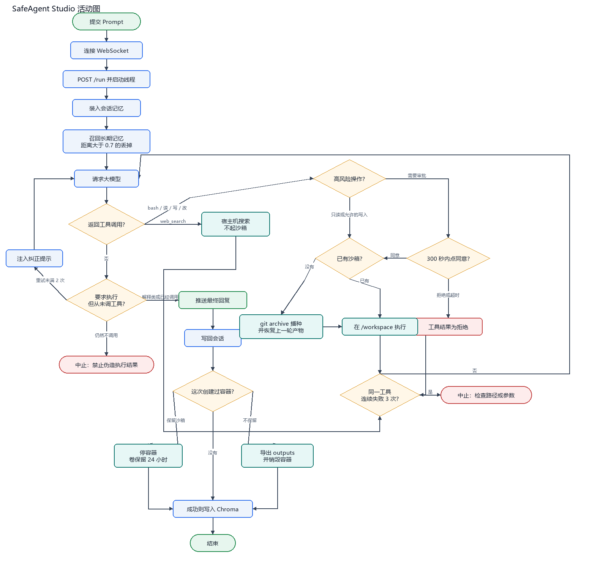
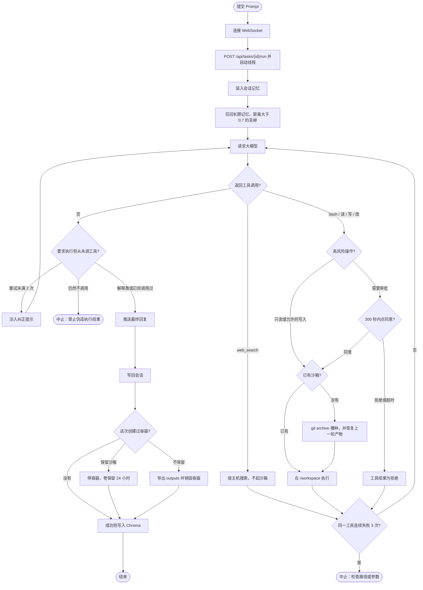

# SafeAgent Studio

写代码的智能体工作台。React 页面提交任务，后端调用大模型，由模型决定读文件、写文件或执行命令。`bash`、`read_file`、`write_file`、`edit_file` 在一次性 Docker 沙箱里执行；`web_search` 在宿主机上查天气和新闻。高风险操作停在审批弹窗里。任务结束后容器销毁，对话、产物和历史经验留下来给下一轮用。

## 架构设计理念

**先问模型，再用沙箱。** 容器在第一次 `bash`、`read_file`、`write_file` 或 `edit_file` 时创建，同一个任务只创建一次。只解释、只查天气的任务不起容器。同时最多 4 只活跃沙箱。工作区来自 `git archive`，排除 `.env`。需要调试时，启动前勾选「保留沙箱」，容器会停掉，卷再留 24 小时。正常结束或失败后导出 `/workspace/outputs/` 并销毁容器。`reaper.py` 每 5 秒按索引里的 `deadline_ts` 回收过期沙箱，进程重启时先对账残留容器。

**有状态记忆。** 计算可以丢掉，结论不能丢。记忆分三层：

- 短期会话：按 `session_id` 记住用户原话和助手最终回复。估算超过 5000 token 时，更早的轮次会被模型收成一段摘要。这份状态在控制面进程内存里。
- 物理产物：删除容器之前，把 `/workspace/outputs/` 导出到 `.worktrees/artifacts/{task_id}/`。下一轮带着 `parent_task_id` 创建沙箱时，这些文件会被拷回 `/workspace`。
- 长期检索：任务成功后，把请求、最终回答和新增产物文件名写入本地 Chroma（`.worktrees/chroma_db/`，集合 `task_memory`）。新任务启动时按余弦距离取最相似的 3 条，距离大于 0.7 的不放进 System Prompt。

**三道检查。**

1. 工具循环。用户要求执行、运行、安装、查看或读取，模型却不调工具、直接写结果时，系统注入纠正提示并重试 2 次，仍然不调用就中止。同一工具连续失败 3 次也会停。新文件必须写在 `outputs/` 下，使用相对路径。
2. 人工审批。改文件、安装、删除和写重定向会停住，等页面上点同意。`pwd`、`ls`、`cat` 等只读命令，以及 `.py`、`.json`、`.txt` 的 `write_file`，可以自动通过。审批在任务线程里用 `threading.Event` 等待，`POST /api/approve` 负责唤醒，300 秒未操作按拒绝处理。
3. 物理隔离。沙箱使用 `--network=none`、`--cap-drop=ALL`、只读根文件系统和 `uid 1000`。实时搜索不进沙箱。

## 活动图

一次任务从页面提交到收尾的顺序。后台 Reaper 不在这条主路径上，它只按截止时间清理过期容器。图由 `activity_map.py` 生成，源文件是 `activity_map.mmd`。





浏览器负责提交、审批弹窗、运行日志和结果卡片。FastAPI 的任务线程调用大模型并执行工具。Docker 只在沙箱工具真正执行时出现。Chroma 在循环开始前注入历史，在任务成功结束时再写一条。

## 目录结构

```text
main.py                      FastAPI、WebSocket、审批和任务线程
reaper.py                    按截止时间回收过期沙箱
session_memory.py            短期会话记忆
memory_store.py              Chroma 长期记忆
utils/logger.py              控制台和 logs/app.log，1MB 滚动保留 3 份
agents/core_agent.py         大模型工具循环、审批判断和懒创建
agents/context_compact.py    把连续重复的工具失败收成一条
agents/sandbox_manager.py    沙箱创建、导出、恢复和销毁
agents/docker/Dockerfile     沙箱镜像 safeagent-sandbox:py310
frontend/                    React + Vite + TypeScript + Ant Design 工作台
tests/                       沙箱、工具和审批脚本
Dockerfile                   控制面镜像
docker-compose.yml           只编排后端
start.ps1                    拉起后端并启动前端
.env.example                 配置模板
```

每次工具调用另写一行到 `.worktrees/traces/{task_id}.jsonl`。

## Quick Start

需要 Docker Desktop、Node.js，以及一份可用的模型网关。Windows 上在仓库根目录执行。

```powershell
Copy-Item .env.example .env
# 编辑 .env，填入 ANTHROPIC_API_KEY 和 MODEL_ID
.\start.ps1
```

`start.ps1` 会执行 `docker-compose up -d --build`，再在 `frontend/` 里运行 `npm run dev`。浏览器打开 http://127.0.0.1:3000 。接口在 http://127.0.0.1:8000 ，健康检查是 `GET /health`。

第一次启动如果还没有 `.env`，脚本会从 `.env.example` 复制一份并停下来，等密钥填好后再运行。

控制面容器挂载了仓库目录和 Docker 套接字，这样它才能 `git archive` 播种工作区，并在宿主机上创建沙箱容器。日志写到 `logs/app.log`，同时打在容器标准输出里。

### 不使用 Compose，直接在本机跑后端

```powershell
pip install -r requirements.txt
python main.py
```

另开一个终端：

```powershell
cd frontend
npm install
npm run dev
```

本机直接运行时，后端默认只监听 `127.0.0.1:8000`。

## 配置

| 变量 | 作用 |
| --- | --- |
| `ANTHROPIC_API_KEY` | 模型网关密钥 |
| `ANTHROPIC_BASE_URL` | 网关地址 |
| `MODEL_ID` | 模型名 |
| `SAFEAGENT_HOST` / `SAFEAGENT_PORT` | 控制面监听地址。Compose 里主机会被设成 `0.0.0.0` |
| `MEMORY_DISTANCE_MAX` | 长期记忆余弦距离上限，默认 `0.7`。更大的结果不注入提示词 |
| `VITE_API_ORIGIN` | 前端请求的后端地址，见 `frontend/.env.development` |

`.env`、`logs/`、`__pycache__/`、`.tasks/`、`.worktrees/artifacts/`、`.worktrees/traces/` 和 `.worktrees/chroma_db/` 不进入版本库。
