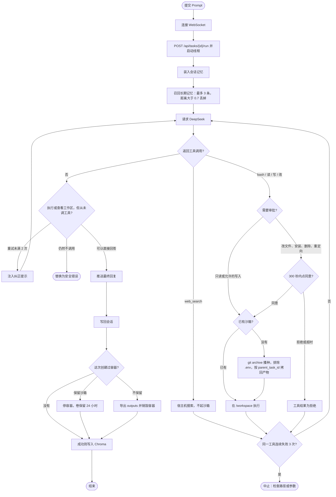

# SafeAgent Studio 活动图

一次任务从页面提交到容器销毁的顺序。图和 `README.md` 里的控制流一致：先召回记忆，再请求 DeepSeek；沙箱在第一次真正执行时才创建。

浏览器提交 Prompt，并用 WebSocket 收状态和审批弹窗。FastAPI 把循环放在独立线程里。解释、讲解和科普可以直接回答。用户要求执行、查看，或询问 `/workspace` 里有什么时，必须出现工具调用；写明「不要调用工具」也不能跳过。未调用时最多再给 2 次机会，仍然不调用就把回答换成安全错误。

`web_search` 留在宿主机。只读命令和允许的写入直接进沙箱；改文件、安装、删除和重定向停在审批弹窗，300 秒没有决定按拒绝处理，这时容器可以还没创建。第一次 `bash`、读、写、改才用 `git archive` 播种，归档排除 `.env`，并按 `parent_task_id` 把上一轮 `outputs/` 拷回。同一个工具连续失败 3 次就熔断。

任务成功后写回会话。估算超过约 5000 token 时，更早的轮次收成摘要。创建过容器时，先导出 `outputs/` 再销毁，或停掉容器并把卷保留 24 小时。Chroma 只在成功结束时写一条；新任务最多取 3 条，余弦距离大于 0.7 的不放进提示词。

Langfuse 在这条控制流旁边记 Trace：根是 `Task-{task_id}`，模型调用是 Generation，工具调用是 Span。密钥留空时不记，也不改变上面的分支。
